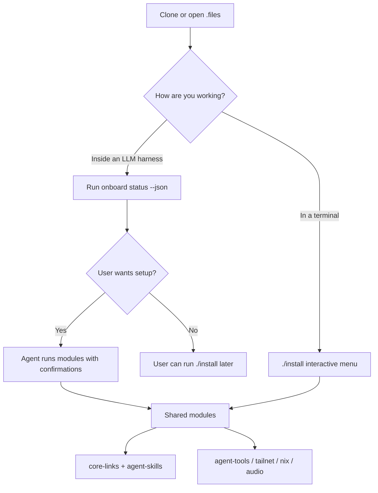

# Setup guide

This repository can be installed two ways. Both call the same modules under
[`scripts/onboard`](../scripts/onboard).



## Method 1 — LLM harness (interactive through chat)

Works with Cursor, Claude Code, Codex, OpenCode, Gemini CLI, Oh My Pi, and similar
tools that read `AGENTS.md` / `CLAUDE.md`.

1. Open this repository in the harness.
2. The agent should run:

```sh
./scripts/onboard status --json
```

3. If onboarding is incomplete, it asks whether you want setup.
4. On yes, it walks modules one by one (or you can say “run `./install` instead”).

Harness autodetection:

```sh
./scripts/onboard detect-harness
```

## Method 2 — Interactive installer (TTY)

From the repo root:

```sh
./install
```

Same thing:

```sh
./scripts/onboard install --interactive
```

Menu options:

1. **Recommended setup** — `core-links` + `agent-skills` (plus optional agent tools prompt)
2. **Full guided setup** — every module with per-module confirmation
3. **Pick modules** — run a custom subset
4. **Status / doctor**
5. **Quit**

Non-interactive examples:

```sh
./scripts/onboard install --module core-links --module agent-skills --yes
./scripts/onboard run agent-tools --yes
```

## Modules

| Module | What it does |
|--------|----------------|
| `core-links` | Symlinks shell, tmux, git, Hyprland, nvim, noctalia, PipeWire fragments, Sunshine config (no credentials), and common CLI helpers into `~` / `~/.local/bin` |
| `fonts` | Installs Nerd Fonts from [`packages/packages.toml`](../packages/packages.toml) (`scripts/install-fonts.sh`) |
| `agent-skills` | Links `workspace-copilot` into Claude, Codex, OpenCode, Gemini, Cursor, OMP, and Agents skill directories |
| `agent-tools` | Runs [`scripts/setup-agent-tools.sh`](../scripts/setup-agent-tools.sh) (Agent Reach, yt-dlp, mcporter) |
| `tailnet-ssh` | Runs [`scripts/setup-tailnet-ssh.sh`](../scripts/setup-tailnet-ssh.sh) (Linux Tailscale + SSH) |
| `nix-home` | Runs [`config/nix/bootstrap-cachyos.sh`](../config/nix/bootstrap-cachyos.sh) on CachyOS/Arch |
| `audio-evolution` | Runs [`scripts/install-audio-evolution.sh`](../scripts/install-audio-evolution.sh) |

State is stored outside git at:

```text
~/.local/state/dotfiles/onboard.json
```

## Fresh machine checklist

1. Clone the repo (HTTPS is fine for public use):

```sh
git clone https://github.com/kvnloo/.files.git ~/workspace/.files
cd ~/workspace/.files
```

2. Choose a path:

```sh
./install                          # terminal menu
# or open the repo in Cursor/Claude/Codex and accept harness onboarding
```

3. Optional deeper CachyOS migration scripts live at
   [`transitions/legacy/cachyos-migration/`](../transitions/legacy/cachyos-migration/).
   [`migration/`](../migration/) is a compatibility symlink.

4. Optional Home Manager details: [`config/nix/README.md`](../config/nix/README.md)

## Doctor

```sh
./scripts/onboard doctor
./scripts/onboard status
./scripts/onboard status --json
```

## Netflix launcher

`config/applications/netflix.desktop` adds **Netflix** to Noctalia and other
desktop application launchers. The `core-links` onboarding module links it into
`~/.local/share/applications/`.

The entry opens Chrome in app mode with `--profile-directory=Default`, the
existing main Chrome profile on this host. It reuses that profile's Netflix
login instead of creating a separate browser profile. It does not add video
upscaling or launch Chrome during installation.
The icon uses the installed Papirus SVG by absolute path so a different active
icon theme cannot replace it with a generic application icon.

On this NVIDIA/Wayland host, `config/chrome-flags.conf` includes
`--disable-gpu-memory-buffer-video-frames`. Chrome 151.0.7922.71 with NVIDIA
615.71.09 otherwise crashes while mapping a DMA-BUF video frame as Netflix
initializes its home page (`Aw, Snap!`, error 4). This disables GPU-backed video
frames, not general GPU rendering, the sandbox, DRM, or extensions.

The standard Chrome launcher reads this shared flags file, so the setting also
applies when normal Chrome starts before the Netflix shortcut. A browser already
running must exit normally and start again to pick up a changed startup flag;
opening another app window alone does not change its process flags.

Netflix app windows share Google Chrome's PulseAudio identity. The Google Chrome
rule in `config/pipewire/pipewire-pulse.conf.d/20-browser-bypass-brir.conf`
routes them to `effect_input.headphone_dsp_movie`, the same Movie DSP configured
for Plex, then to the Topping DX5. This also affects other Google Chrome audio;
Chromium, Firefox, and Brave retain their existing Aural Evolution route.
Movie DSP applies headphone EQ and a limiter without Room's BRIR, loudness, or
multiband-compressor stages. The desktop's default sink is independent of this
per-application rule.

Application volume is separate from sink volume. A Chrome stream at 0% remains
silent even when the DAC is at 100%. Inspect the current stream with
`pactl --format=json list sink-inputs`; stream IDs change when playback resumes.
WirePlumber saves application volume. Changing the browser routing rule requires
a `pipewire-pulse` service restart, which briefly interrupts PulseAudio clients;
moving one live stream alone does not change the rule for subsequent streams.

## Noctalia group colors

`config/noctalia/user-templates.toml` registers the native
`hyprland-group-colors.conf` template. With **User theming** enabled, Noctalia
renders the selected preset or wallpaper scheme into
`~/.cache/noctalia/hyprland-group-colors.conf`. Its post-hook applies only the
14 border and group-tab color settings through one `hyprctl --batch` call.
It does not reload the compositor, change the selected scheme, or enable the
built-in Hyprland template.

Wallpaper-driven pywal updates retain those generated Noctalia colors while
keeping terminal colors and the hyprglass tint wallpaper-driven. The
`core-links` onboarding module also links the user-template registration when
the live Noctalia directory is not a symlink.

The live legacy compositor still sources its existing pywal cache. After a
manual compositor reload, reapply the current scheme in Noctalia if stale
colors return; changing that watched source would also activate unrelated
pending compositor configuration. Ordinary Noctalia scheme changes do not
require a compositor or shell restart.

## Apple Magic Trackpad

Hyprland matches the connected device as `apple-inc.-magic-trackpad`.
The legacy config, canonical mirror, and Lua candidate use adaptive pointer
acceleration for this device; the wired mouse keeps the global flat profile.
Natural two-finger scrolling, tap-to-click, clickfinger buttons, and tap-drag
are enabled. Three-finger drag is disabled to preserve workspace swipes.

| Gesture | Action |
| --- | --- |
| Two-finger scroll / pinch | Application-native scrolling / zoom |
| Three-finger horizontal swipe | Finger-following workspace switch |
| Three-finger up | Rofi window picker |
| Four-finger left / right | Previous / next window in the active group |
| Four-finger up | Noctalia launcher |
| Four-finger down | Toggle `scratch_term` |

Workspace motion is horizontal; swipes do not create empty workspaces.
This uses Hyprland's native gestures, not a separate input daemon or raw-input
logging. Window picking is not a macOS Mission Control thumbnail overview.

Workspace Copilot remains advisory: prepare without focus changes, surface
rarely, commit only by explicit invocation (`Super+Space`). Predictive navigation
is not bound to a swipe. The existing Workspace Atlas capture switches
workspaces and is deliberately not used as the window-picker gesture.

Validate with `Hyprland --verify-config -c config/hyprland/hyprland.legacy.conf`
and the equivalent `hyprland.conf` / `hyprland.lua` paths. Reload the active
legacy config with `hyprctl reload`; do not activate or restart into Lua as part
of gesture setup. Lua uses underscore device fields, callback gesture actions,
and `workspace_name` with Hyprland 0.56.2.
Physical swipe direction, cancellation, app zoom, and click feel still require
a trackpad check; parsing and reload receipts do not prove those interactions.

## Legacy entry points

- [`script.sh`](../script.sh) now forwards to `./install` (old macOS/Ubuntu menu is retired).
- [`migration/08-master-migration.sh`](../migration/08-master-migration.sh) remains the one-shot CachyOS migration orchestrator for rebuilds, not the default daily onboarding path. It resolves the repo root by walking to `.git`, so the compatibility symlink is safe.

## Safety

- Do not commit Sunshine `credentials/`, `sunshine_state.json`, or logs.
- Agent Reach secrets stay in `~/.agent-reach` (untracked).
- `wallhaven` / MCP / provider API keys are never stored in this repo’s tracked configs.
