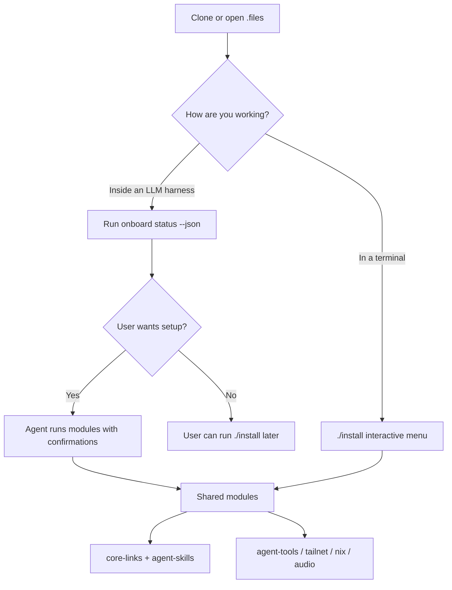

# Setup guide

This repository can be installed two ways. Both call the same modules under
[`scripts/onboard`](../scripts/onboard).



## Desktop file manager

The desktop host uses Strata as the default folder handler (`inode/directory`).
**Super+E** opens `~/.local/bin/strata`. **Super+Shift+E** is unbound.
Super+E replaces the previous split-direction shortcut.
The Hyprlang and Lua configurations contain the same explorer bindings.
The release pin and runtime dependencies are recorded in `fleet.toml`.
The system file chooser and FileManager1 D-Bus provider remain unchanged.

## Memory archive read paths on groot

ctx and AgentsView reject a symlink as their private runtime root. Groot relocates
both archives. Use their canonical roots, not `~/.ctx` or `~/.agentsview`:

```sh
export CTX_DATA_ROOT=/mnt/zer0models/host-offload/home_kvn_.ctx
export AGENTSVIEW_DATA_DIR=/mnt/zer0models/sft-svlm/data/agentsview
```

`config/zsh/env.zsh` supplies these defaults when the directories exist. It preserves
explicit overrides. `environment.d` supplies user-service settings. The z0int tick
inherits the service environment instead of overriding AgentsView with a symlink.
Existing terminal or agent processes do not acquire new environment variables.
Pass the variables explicitly to those processes. Do not restart a live agent to
repair a read-only query.

Read-only acceptance commands:

```sh
env CTX_DATA_ROOT=/mnt/zer0models/host-offload/home_kvn_.ctx \
  ctx search 'forgot memory correction' --since 14d --refresh off --limit 4 --format json
env AGENTSVIEW_DATA_DIR=/mnt/zer0models/sft-svlm/data/agentsview AGENTSVIEW_NO_DAEMON=1 \
  agentsview session search forgot --fts --since 14d --context 2 --json --limit 4
```

Canonical paths remove runtime validation failures. They do not fix query latency,
missing semantic embeddings, stale ingestion, or missing scope filters. Set a caller
deadline. A timeout is unavailable, not an empty result. `--refresh off` avoids ctx
refresh work. AgentsView's `AGENTSVIEW_NO_DAEMON=1` suppresses daemon autostart but can
still route a query through an existing server.

The October 23 read-health audit found intermittent ctx timeouts, AgentsView HTTP
timeouts, no AgentsView semantic configuration, and incomplete TencentDB ingestion
and scope exposure. Preserve native source access as the fallback. Do not ingest
private transcripts or enable new scope grants as a health repair.


## Method 1 — LLM harness (interactive through chat)

Works with Cursor, Claude Code, Codex, OpenCode, Gemini CLI, Oh My Pi, and similar
tools that read `AGENTS.md` / `CLAUDE.md`.

1. Open this repository in the harness.
2. The agent should run:

```sh
./scripts/onboard status --json
```

3. If onboarding is incomplete, it asks whether you want setup.
4. On yes, it walks modules one by one (or you can say “run `./install` instead”).

Harness autodetection:

```sh
./scripts/onboard detect-harness
```

## Method 2 — Interactive installer (TTY)

From the repo root:

```sh
./install
```

Same thing:

```sh
./scripts/onboard install --interactive
```

Menu options:

1. **Recommended setup** — `core-links` + `agent-skills` (plus optional agent tools prompt)
2. **Full guided setup** — every module with per-module confirmation
3. **Pick modules** — run a custom subset
4. **Status / doctor**
5. **Quit**

Non-interactive examples:

```sh
./scripts/onboard install --module core-links --module agent-skills --yes
./scripts/onboard run agent-tools --yes
```

## Modules

| Module | What it does |
|--------|----------------|
| `core-links` | Symlinks shell, tmux, git, Hyprland, nvim, noctalia, PipeWire fragments, Sunshine config (no credentials), and common CLI helpers into `~` / `~/.local/bin` |
| `fonts` | Installs Nerd Fonts from [`packages/packages.toml`](../packages/packages.toml) (`scripts/install-fonts.sh`) |
| `agent-skills` | Links `workspace-copilot` into Claude, Codex, OpenCode, Gemini, Cursor, OMP, and Agents skill directories |
| `agent-tools` | Runs [`scripts/setup-agent-tools.sh`](../scripts/setup-agent-tools.sh) (Agent Reach, yt-dlp, mcporter) |
| `tailnet-ssh` | Runs [`scripts/setup-tailnet-ssh.sh`](../scripts/setup-tailnet-ssh.sh) (Linux Tailscale + SSH) |
| `nix-home` | Runs [`config/nix/bootstrap-cachyos.sh`](../config/nix/bootstrap-cachyos.sh) on CachyOS/Arch |
| `audio-evolution` | Runs [`scripts/install-audio-evolution.sh`](../scripts/install-audio-evolution.sh) |

State is stored outside git at:

```text
~/.local/state/dotfiles/onboard.json
```

## Fresh machine checklist

1. Clone the repo (HTTPS is fine for public use):

```sh
git clone https://github.com/kvnloo/.files.git ~/workspace/.files
cd ~/workspace/.files
```

2. Choose a path:

```sh
./install                          # terminal menu
# or open the repo in Cursor/Claude/Codex and accept harness onboarding
```

3. Optional Home Manager details: [`config/nix/README.md`](../config/nix/README.md)

## Doctor

```sh
./scripts/onboard doctor
./scripts/onboard status
./scripts/onboard status --json
```

## Tern remote reconnection

Groot uses Tern's system `tern-remote.service`, installed by Tern and enabled
at boot. The phone connects as `kvn@0.taila30dc.ts.net`; incoming SSH to the
phone uses its PRoot account, `root`, not `kvn`. Keep the existing host keys
and access policy. Never replace a pin merely because a connection fails.

Tern updates replace `~/.local/bin/tern`. A remote service still running the
old executable can authenticate clients but fail to spawn its login process
with `No such file or directory`. Existing connections can continue until
the client restarts, which makes this look like a phone reconnection failure.

Install the tracked update recovery after Tern's system service exists:

```sh
./scripts/setup-tern-remote-refresh.sh
```

The installer copies the helper and units into root-owned system paths.
`tern-remote-refresh.timer` checks every 30 seconds, including after boot.
The helper compares the running executable's device/inode with the installed
binary. It validates a replacement with `--version` before restarting only
the active remote service. Unchanged binaries and intentionally stopped
services remain untouched. It requires `KillMode=process`, so session daemons
and shells survive the transport restart. Remote clients may briefly reconnect.
The timer does not depend on available inotify watches.

```sh
systemctl status tern-remote.service tern-remote-refresh.timer
journalctl -u tern-remote.service -u tern-remote-refresh.service
```

The phone's saved `hosts` and `known_hosts` files stay in its normal
`~/.config/tern`. No alternate profile, GUI restart, authentication bypass,
or duplicate daemon is required.

## Tern Carly

`core-links` installs `config/tern/settings.json` at
`~/.config/tern/settings.json`. Carly follows `@smol`, whose current global OMP
assignment is `openai-codex/gpt-6-luna`. Change model roles through OMP's
protected configuration interface, not a separate hardcoded Carly model.

Both tmux and Tern's tmux preset use **Ctrl+B** as the prefix. tmux has no
secondary prefix. Ctrl+Space is not a prefix in either application.

Tern keeps its built-in tmux preset and adds the navigation overrides from
`config/.tmux.conf`. Press and release **Ctrl+B**, then press the second key:

| Second key | Tern action |
| --- | --- |
| `h` / `j` / `k` / `l` | Focus left / down / up / right |
| `Shift+h` / `Shift+j` / `Shift+k` / `Shift+l` | Resize in that direction |
| `-` / `\|` | Split down / right |
| `Tab` | Return to the previous tab |
| `r` | Reload Tern settings |

`Ctrl+B, l` now means focus right. Previous-tab access remains available through
`Ctrl+B, Tab` and Tern's `Ctrl+Shift+Tab`. Stock preset arrows, `%`, `"`, `c`,
`n`, `p`, `o`, `z`, and `x` remain. This is a Tern keymap, not a tmux command
interpreter: tmux copy-mode tables, server management, plugins, and shell popups
do not automatically transfer. The cheatsheet applies these user overrides.

Tern manages its own OMP at `~/.local/share/tern/omp/bin/omp`; updating the Bun
installation alone does not establish which runtime Carly launches. The
Tern-managed OMP 18.9.2 successfully resolves `--model @smol` to GPT-6 Luna and
answers RPC `get_state`. Earlier 18.8.9 startup rejected that alias.

RPC startup is not proof of realtime voice: microphone capture, provider
connection, listening, and speaking require separate checks.

## Netflix launcher

`config/applications/netflix.desktop` adds **Netflix** to Noctalia and other
desktop application launchers. The `core-links` onboarding module links it into
`~/.local/share/applications/`.

The entry opens Chrome in app mode with `--profile-directory=Default`, the
existing main Chrome profile on this host. It reuses that profile's Netflix
login instead of creating a separate browser profile. It does not add video
upscaling or launch Chrome during installation.
The icon uses the installed Papirus SVG by absolute path so a different active
icon theme cannot replace it with a generic application icon.

On this NVIDIA/Wayland host, `config/chrome-flags.conf` includes
`--disable-gpu-memory-buffer-video-frames`. Chrome 151.0.7922.71 with NVIDIA
615.71.09 otherwise crashes while mapping a DMA-BUF video frame as Netflix
initializes its home page (`Aw, Snap!`, error 4). This disables GPU-backed video
frames, not general GPU rendering, the sandbox, DRM, or extensions.

The standard Chrome launcher reads this shared flags file, so the setting also
applies when normal Chrome starts before the Netflix shortcut. A browser already
running must exit normally and start again to pick up a changed startup flag;
opening another app window alone does not change its process flags.

Netflix app windows share Google Chrome's PulseAudio identity. The Google Chrome
rule in `config/pipewire/pipewire-pulse.conf.d/20-browser-bypass-brir.conf`
routes them to `effect_input.headphone_dsp_movie`, the same Movie DSP configured
for Plex, then to the Topping DX5. This also affects other Google Chrome audio;
Chromium, Firefox, and Brave retain their existing Aural Evolution route.
Movie DSP applies headphone EQ and a limiter without Room's BRIR, loudness, or
multiband-compressor stages. The desktop's default sink is independent of this
per-application rule.

Application volume is separate from sink volume. A Chrome stream at 0% remains
silent even when the DAC is at 100%. Inspect the current stream with
`pactl --format=json list sink-inputs`; stream IDs change when playback resumes.
WirePlumber saves application volume. Changing the browser routing rule requires
a `pipewire-pulse` service restart, which briefly interrupts PulseAudio clients;
moving one live stream alone does not change the rule for subsequent streams.

## Noctalia group colors

`config/noctalia/user-templates.toml` registers the native
`hyprland-group-colors.conf` template. With **User theming** enabled, Noctalia
renders the selected preset or wallpaper scheme into
`~/.cache/noctalia/hyprland-group-colors.conf`. Its post-hook applies only the
14 border and group-tab color settings through one `hyprctl --batch` call.
It does not reload the compositor, change the selected scheme, or enable the
built-in Hyprland template.

Wallpaper-driven pywal updates retain those generated Noctalia colors while
keeping terminal colors and the hyprglass tint wallpaper-driven. The
`core-links` onboarding module also links the user-template registration when
the live Noctalia directory is not a symlink.

The live legacy compositor still sources its existing pywal cache. After a
manual compositor reload, reapply the current scheme in Noctalia if stale
colors return; changing that watched source would also activate unrelated
pending compositor configuration. Ordinary Noctalia scheme changes do not
require a compositor or shell restart.

## Noctalia keybind cheatsheet

`config/noctalia/plugins/keybind-cheatsheet` vendors upstream 3.7.4 from
[`noctalia-dev/legacy-v4-plugins` at `aa30139`](https://github.com/noctalia-dev/legacy-v4-plugins/commit/aa30139adf4691a284cd44ed5020ac631039efd9),
with a native same-side Super triple-tap trigger and a refined presentation
based on macOS CheatSheet's grouped-column layout. The upstream plugin
structure, search, and settings remain; this is not app-specific macOS menu
discovery.

On Groot, keyd emits F13 for a bare left-Super tap and F14 for a bare
right-Super tap; a Super+key chord emits neither sentinel. Hyprland matches
raw keycodes `191`/`192` and routes them to `tap-left`/`tap-right`. XKB's US
layout names these keys `XF86Tools`/`XF86Launch5`, not F13/F14; symbol-based
F13/F14 bindings do not match. Three completed taps
from the same side within 700 ms toggle the sticky panel. `Super+/`, IPC, and
the bar widget remain manual toggles.

`Presentation.js` groups desktop actions and supplies readable labels while
retaining raw commands for search and tooltips. Unknown commands stay visible.
The conf parser records submap context so mode-only keys are not presented as
global shortcuts. Noto Sans body text, standard modifier/arrow glyphs, and
existing Noctalia icons avoid a dependency on a particular Nerd Font family.
Actions lead each row; right-aligned shortcuts use subdued modifiers and
semibold trigger keys. Theme-accent headings, wider column gutters, and a
bounded search field separate navigation from content. Rows have a measured
22px baseline at normal scale; italics are reserved for secondary hints.
Columns fit the available screen width without horizontal scrolling, and
search results rebalance and reduce the panel height.

An immediately following, same-key reset in the same mode is shown as a
`↩` hint on its action instead of a duplicate row. Both original commands
remain searchable and available in tooltips. Standalone exits, custom reset
descriptions, and overridden resets stay separate; cached bindings are not
rewritten.

Headless Sway checks covered 1440×1000 and 900×800 outputs, parser/search
behavior, and the same-side triple-tap panel toggle. They do not exercise the
physical keyd F13/F14 sentinels or Hyprland GlobalShortcut delivery. The
complete sheet, including its mode sections, was visually inspected. Reference:
[Media Atelier CheatSheet screenshot and review](https://www.macstories.net/mac/cheatsheet-quickly-lists-an-apps-keyboard-shortcuts/).

Run `scripts/install-noctalia-audio-overlay.py` after updating the shell
overlay: it forwards the plugin's keyboard policy and clears stale keyboard
initialization. Run `hyprctl reload` to register the raw-code bindings, then disable and
re-enable the keybind-cheatsheet plugin in Noctalia Settings to register its
new GlobalShortcut handlers. No Lua configuration migration is required.
Refresh the cached binding metadata after upgrading the parser with
`qs -c noctalia-shell ipc --any-display call plugin:keybind-cheatsheet refresh`.

The physical Wooting/Caps sentinel path and Hyprland GlobalShortcut delivery
still require native validation. Generated `settings.json` remains gitignored.

## Apple Magic Trackpad

Hyprland matches the connected device as `apple-inc.-magic-trackpad`.
The legacy config, canonical mirror, and Lua candidate use adaptive pointer
acceleration for this device; the wired mouse keeps the global flat profile.
Natural two-finger scrolling, tap-to-click, clickfinger buttons, and tap-drag
are enabled. Three-finger drag is disabled to preserve workspace swipes.

| Gesture | Action |
| --- | --- |
| Two-finger scroll / pinch | Application-native scrolling / zoom |
| Three-finger horizontal swipe | Finger-following workspace switch |
| Three-finger up | Rofi window picker |
| Four-finger left / right | Previous / next window in the active group |
| Four-finger up | Noctalia launcher |
| Four-finger down | Toggle `scratch_term` |

Workspace motion is horizontal; swipes do not create empty workspaces.
This uses Hyprland's native gestures, not a separate input daemon or raw-input
logging. Window picking is not a macOS Mission Control thumbnail overview.

Workspace Copilot remains advisory: prepare without focus changes, surface
rarely, commit only by explicit invocation (`Super+Enter`). Predictive navigation
is not bound to a swipe. The existing Workspace Atlas capture switches
workspaces and is deliberately not used as the window-picker gesture.

Validate with `Hyprland --verify-config -c config/hyprland/hyprland.legacy.conf`
and the equivalent `hyprland.lua` path. Reload the active
legacy config with `hyprctl reload`; do not activate or restart into Lua as part
of gesture setup. Lua uses underscore device fields, callback gesture actions,
and `workspace_name` with Hyprland 0.56.2.
Physical swipe direction, cancellation, app zoom, and click feel still require
a trackpad check; parsing and reload receipts do not prove those interactions.

## Global desktop Normal/Insert modes

`config/keyd/default.conf` provides an opt-in global mode for the Wooting
main keyboard interface `31e3:1312:629432a5`. Auxiliary Wooting interfaces,
other keyboards, mice, and trackpads are excluded.
A fresh keyd start uses Insert. Physical Escape enters Normal (consuming that
first Escape); plain `i` returns to Insert. Further Escapes in Normal reach the
app. `Ctrl+Alt+Space` clears the mode and recovers to Insert.

In Normal, bare `h/j/k/l` emit `Super+h/j/k/l`, using the existing Hyprland/
Phantomat focus bindings. Other listed ANSI printable keys are blocked until
Insert. Enter Insert before using app sequences such as Tern's `Ctrl+B, h`.
Explicit Super/Ctrl/Alt mappings retain their modifiers. Focus changes and
mouse clicks do not change the mode.

Caps is Super in Insert, so a bare Caps tap may share the left-Super
cheatsheet trigger. In Normal, a tap emits Escape; holding for 200 ms or
pressing another key activates Super. Caps+Enter therefore emits Super+Enter
in either mode, invoking the existing explicit next-action commit.

There is no catchall, Fn remap, or Wooting firmware edit. Unlisted keycodes
pass through. A Fn-layer action that emits one of the blocked printable codes
cannot be distinguished from that ordinary key in Normal. The physical Caps
event, complete Fn profile, and Super/Caps tap-sentinel path still require a
hardware check; no profile or HID input was captured during isolated verification.

Hyprland's `caps:super` fallback stays unchanged for other keyboards. The
Noctalia submap indicator observes Hyprland, not keyd; it does not show this
mode. Offline validation is `keyd check config/keyd/default.conf`. The native
keyd 2.6.0 input-isolated engine also verified mode transitions, blocked typing,
navigation, modifier retention, Caps tap/chords, recovery, and representative
Fn output keycodes without opening an input device.

Setup requires separate approval to intercept the Wooting:

```sh
scripts/setup-desktop-modal.sh install   # package/config only; no activation
scripts/setup-desktop-modal.sh activate  # enable/restart only after approval
scripts/setup-desktop-modal.sh disable   # stop interception and disable boot start
```

The installer preserves an existing `/etc/keyd/default.conf` in a unique
`default.conf.backup.*` file and refuses other `.conf` files that could widen
device scope. To restore an older setup, disable first, then restore that
backup. Do not remove the keyd package if another setup needs it. Upstream's
emergency `Backspace+Escape+Enter` chord terminates keyd.

`/run/keyd.socket` is root-equivalent: it accepts bindings, text input, and
`command()` actions that keyd runs as root. Never add users to the `keyd` group
or ACLs to that socket; `activate` empties the group and resets the socket ACL.
`mode-border` reads layer state from `/run/keyd-layers.sock` (kvn only, 0600).
`keyd-layers.service` runs the root-owned `/usr/local/bin/keyd-layers` as a
dynamic user with only the `keyd` group. It holds one `keyd listen` connection
and forwards `/layout` snapshots and `+/-normal`. Modifier layers are dropped
because their timing reveals typing. Client input is discarded.

## Safety

- Do not commit Sunshine `credentials/`, `sunshine_state.json`, or logs.
- Agent Reach secrets stay in `~/.agent-reach` (untracked).
- `wallhaven` / MCP / provider API keys are never stored in this repo’s tracked configs.
